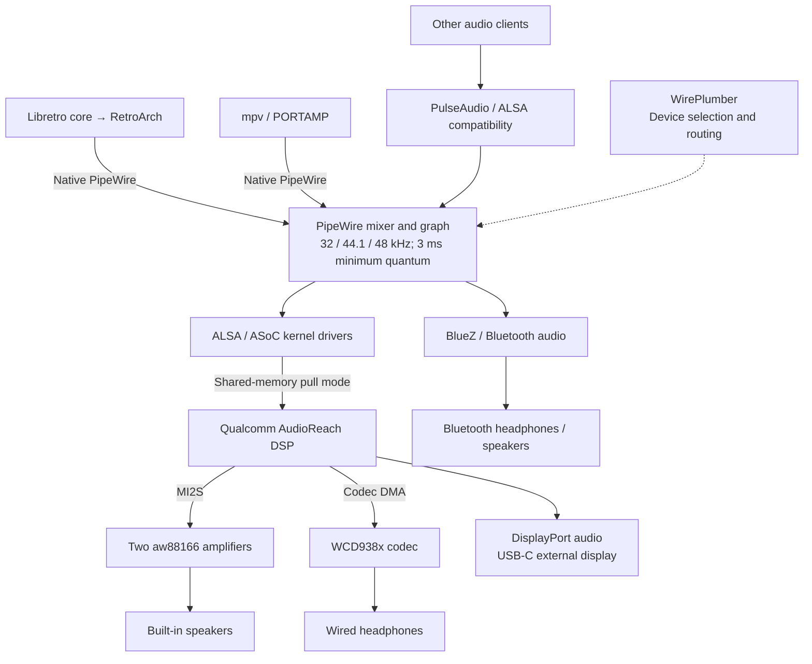
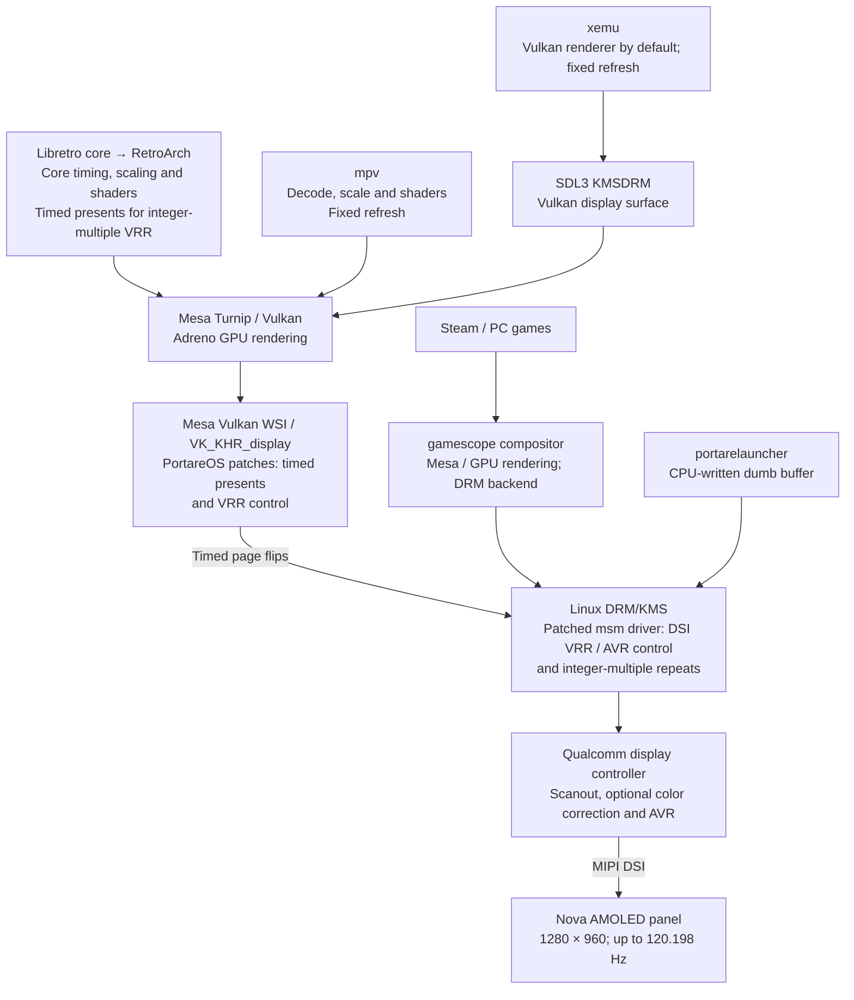

# PortareOS

**For Retroid Pocket Nova owners who care about every frame and millisecond.**

[Home](https://os.portare.org) · **[Features](documentation/FEATURE_OVERVIEW.md)** · **[Installation guide](documentation/INSTALLATION.md)** · [Known issues](BUGS.md) · [Roadmap](ROADMAP.md)

> Black coffee without sugar and milk. With the right amount of beans and water.

PortareOS tunes the whole stack for low latency, consistent frame delivery
and faithful console timing on the Nova's 1280×960 panel, at variable
refresh up to 120 Hz. Hardware follows the console's refresh and audio
rates wherever possible. Correctness comes first, then latency; features
that serve neither come out.

Write the card, copy your games across, and play. One emulator per system,
with configs, scaling and shaders tuned for this device; tweaking is not
expected. **Nova only, NTSC focused.** Other device trees have been deleted.
PAL is not planned, though fixes that preserve NTSC behaviour are welcome.
16:9 systems, except PSP, are not supported.

[Installation and use](#installation-and-everyday-use) · [Systems and status](#systems-and-status) · [Screenshots](#what-it-looks-like) · [Technical details](#design-and-performance) · [Building](#building)

## Installation and everyday use

Follow the **[installation guide](documentation/INSTALLATION.md)**. The first image
requires a fresh card installation: PortareOS's own boot partition label
prevents in-place updates from ROCKNIX. Later updates download from GitHub
over Wi-Fi through the launcher, using the nightly or release channel, and
install on restart.

[portarelauncher](https://github.com/portare-ch/portarelauncher) provides
consoles, games and settings for Wi-Fi, Bluetooth, SSH, USB mode, language
and time zone, and updates, in English or Japanese. Each device generates a root password on first boot, shown
under About.

* **Home + Start** quits every emulator; **M1 + volume** adjusts brightness
  anywhere.
* **M2** in RetroArch opens a game guide: place a text file beside the ROM
  with its name and `.txt`. The game pauses; M2 or B returns to it.
* **L1 + Y** shows or hides the MangoHud performance overlay in a game. The
  overlay is off by default; `portareos.mangohud.enabled=1` in `system.cfg`
  loads it, or `psx.portareos.mangohud.enabled=1` for one system.
* **Settings > Consoles > PRMPT** enables an experimental pre-emptive frame
  per 2D console. PlayStation keeps its measured configuration without this
  switch because the performance cost was too high.

## Systems and status

**Early development: things may break.** Compatibility and performance vary
by game. Status notes below cover specific tests, not every included system.

| System | Emulator / player | Status notes |
| --- | --- | --- |
| Arcade, Neo Geo | FBNeo | — |
| Neo Geo CD | [NeoCD](documentation/emulators/NeoCD.md) | ✅ Tested and tuned: full-screen 4:3, scanlines, one preemptive frame, 4.3 ms pad to panel ([#666](https://github.com/portare-ch/portareos/issues/666)) |
| Game Boy, Game Boy Color | Gambatte | — |
| Game Boy Advance | mGBA | — |
| NES, Famicom, Famicom Disk System | MesenCE | — |
| Super Nintendo | Snes9x | ✅ Tested; bsnes was too costly |
| Nintendo 64 | ParaLLEl N64 with ParaLLEl-RDP on Vulkan | — |
| GameCube, Wii | Dolphin (libretro) | ❌ GameCube: hangs, no sound ([#463](https://github.com/portare-ch/portareos/issues/463)) |
| Master System, Game Gear, Mega Drive, Sega CD | Genesis Plus GX | — |
| 32X | PicoDrive | — |
| Dreamcast, NAOMI, Atomiswave | Flycast | — |
| PlayStation | [SwanStation](documentation/emulators/SwanStation.md) | ✅ Tested |
| Saturn | Ymir | — |
| PlayStation 2 | [ARMSX2 (libretro)](documentation/emulators/ARMSX2.md) | 🚧 Playable; optimization ongoing ([#477](https://github.com/portare-ch/portareos/issues/477)) |
| PSP | PPSSPP | — |
| Xbox | xemu | — |
| Point-and-click | ScummVM | — |
| PC (x86 through FEX) | Steam on gamescope | ✅ Tested 2026-10-05; details below |
| Movies, music | mpv, PORTAMP | — |

Steam launches from the launcher again ([#533](https://github.com/portare-ch/portareos/pull/533));
SUPERHOT runs with sound ([#535](https://github.com/portare-ch/portareos/pull/535),
[#536](https://github.com/portare-ch/portareos/pull/536)), and Big Picture uses
a readable 1.6 scale ([#534](https://github.com/portare-ch/portareos/pull/534)).

**Disc games are CHD only** (PlayStation, PlayStation 2, Dreamcast, Neo Geo
CD; the other disc systems follow). CHD is lossless, the disc comes back bit for
bit, and it is a fraction of the size of a CUE/BIN or ISO. The card has to
stay well below full: flash storage slows down heavily as it nears its
capacity, and a smaller library is a faster one. So the format is forced
rather than offered, and [nova-push](https://github.com/portare-ch/portareos_tools)
converts a CUE, GDI or ISO on the way to the device. An `.m3u` that names
CHDs still works for a multi-disc game.

See [folders, formats and cores](documentation/PER_DEVICE_DOCUMENTATION/SM8550/SUPPORTED_EMULATORS_AND_CORES.md)
for game setup, [emulator notes](documentation/emulators/README.md) for
measurements and configuration decisions, and
[removed packages](documentation/REMOVED_PACKAGES.md) for alternatives dropped
along with their untuned settings.

[Known issues](BUGS.md) tracks observed problems and changes awaiting device
testing. The [roadmap](ROADMAP.md) covers suspend power, the SNES core
choice and further footprint reductions.

## What it looks like


**Super Mario World.** SNES timing at 120.198 Hz, exact 4× CRT scanlines
with 32-pixel bars, and a 32 kHz audio link.


**A DVD rip.** Hardware H.264/HEVC decoding, direct Vulkan output, restored
4:3 aspect for SD rips missing aspect flags, and scanlines. Playback position
is saved on quit.


**The launcher.** Text on black: systems with games, game counts, volume,
brightness, battery and time.

## Design and performance

Kernel, emulators, DSP topology, display driver, input path and frontend are
all open to change. Measurements guide the work.

### Integer-multiple variable refresh at the console's rate

RetroArch enables variable refresh automatically on the built-in panel
when it is the only connected display and no display mode is pinned.
The panel follows timed frames within an 80–120.198 Hz range, using the
display controller's AVR, the hardware behind Qualcomm's Qsync.

RetroArch paces the game at the core's reported frame rate, and our Mesa
Vulkan WSI patches time its presentation. The kernel's display driver
handles integer-multiple scanout: it repeats each frame at evenly spaced
intervals to keep the panel within its refresh range, without rendering
or submitting the frame again. For the usual NTSC rates, that means two
scans: 2 × 59.8261 Hz for the PlayStation, 2 × 60.0988 Hz for the SNES.
Lower rates use more repeats, such as four scans at 30 fps. All systems
use the fastest panel mode as the base for variable refresh.

RetroArch always keeps vsync off and Sync to Exact Content Framerate on,
including at fixed refresh. Rates too high to fit twice, such as arcade
boards near 61 Hz, are refused on the variable-refresh path: “This game is
not supported” appears, then RetroArch returns to the launcher.

In 10-minute runs on 9 October 2026 with kernel repeats, Super Mario World
showed 35,963 of 35,967 frames twice, and Tekken 3 showed 35,781 of 35,793
twice. Late frames and startup can still disrupt the cadence. See
[variable refresh](documentation/VARIABLE_REFRESH.md) for the hardware,
measurements and design.

Fixed refresh remains for xemu, Steam and mpv, and for RetroArch when
variable refresh is disabled. To compare, set `global.vrr=0` in
`/storage/.config/system/configs/system.cfg`; use `snes.vrr=0` for one
system or `snes["Super Mario World.sfc"].vrr=0` for one ROM filename.
With fixed refresh, RetroArch selects a mode from the table below and
still times frames at the core's rate; each is shown at the next refresh.

| Panel mode | Console | Frame rate |
| --- | --- | --- |
| 119.880 Hz | Dreamcast, PS2, PSP, GameCube, Xbox; default mode | 59.94 |
| 119.653 Hz | PlayStation, Nintendo 64, Saturn | 59.8261 |
| 119.455 Hz | Game Boy, Game Boy Color, Game Boy Advance | 59.7275 |
| 120.198 Hz | Super Nintendo, NES | 60.0988 |
| 119.846 Hz | Master System, Game Gear, Mega Drive, Mega CD | 59.9227 |
| 118.360 Hz | Neo Geo | 59.18 |
| 119.200 Hz | Neo Geo CD | 59.5999 |
| 120.000 Hz | Steam: PC games capped at 60 or 120 by a timer | 60 |

Every mode now uses the panel's own 1302 × 998 timing, changing only the
pixel clock. The wider blanking used previously let the panel lose lock
and tear under variable refresh. Modes are within 3.2 parts per million
of their target rates, except the fastest, SNES/NES, which is rounded
slightly up (+4.4 ppm) so doubled SNES frames fit. SwanStation does not yet follow
real PlayStation mid-game rate changes. See
[refresh rates](documentation/PER_DEVICE_DOCUMENTATION/SM8550/REFRESH_RATES.md)
for implementation and measurements.

**Black frame insertion has been removed**, along with the vsync settings
it depended on. Previously saved values are cleared automatically.

### Audio stack

Audio flows from the application through PipeWire to the selected output.
The solid arrows carry audio; the dotted arrow shows WirePlumber's routing
and device policy.



The built-in speaker and headphone links follow supported stream rates.
Bluetooth and external displays negotiate their own formats and buffering;
the graph's quantum is not the end-to-end audio latency.

### Audio at the console's sample rate

Kernel and DSP changes let the audio link follow the core's output at 48,
44.1 or 32 kHz. RetroArch selects the rate when opening the audio device.

| Link rate | Consoles |
| --- | --- |
| 44.1 kHz | PlayStation, Dreamcast, PSP, Neo Geo CD, every Sega system; N64 games at 22 or 44.1 kHz |
| 32 kHz | Super Nintendo; N64 games at 32 kHz |
| 48 kHz | PS2, Xbox, GameCube and Wii, and everything else |

N64 rates vary by game; the core reports the programmed rate and the device
reopens at the matching link rate. Resampling is avoided where hardware
supports the rate; the SNES's exact 32040 Hz is unavailable. See
[audio sample rates](documentation/PER_DEVICE_DOCUMENTATION/SM8550/AUDIO_SAMPLE_RATES.md)
for hardware limits and emulator output rates.

### Lower audio latency

**AudioReach shared-memory pull mode** gives the driver a sample-accurate
position. Removing `SNDRV_PCM_INFO_BATCH` stops PipeWire adding a period of
batch-device headroom. Qualcomm DSP periods follow the stream's rate:
10 ms instead of 480 frames, which previously meant 15 ms for SNES audio.
PortareOS configures PipeWire for a 3 ms graph quantum. Current PCM
measurements and the remaining latency budget are documented in
[audio latency](docs/audio-latency.md).

RetroArch defaults to **8 ms**, down from the observed 32 ms crackle-free
floor. This setting is not end-to-end latency. Camera tests showed
improvement, though audio latency remains somewhat higher than Android.

### Configured for this panel

* Integer scaling to fit the 960-line panel: Game Boy at 960×864, GBA at 5×,
  N64 at 2× on ParaLLEl-RDP, and PlayStation at 4×. Game Boy, GBC and GBA
  use LCD shaders; PlayStation uses our CRT shader. SNES uses
  crt-guest-advanced at exact 4×, keeping 32-pixel bars around 224 lines to
  preserve even scanlines.
* Correct palettes and boot logos, with GBC hardware and color correction
  for Game Boy Color.
* Optional sRGB/D65 color correction through the display controller applies
  to games, films and the launcher. **Both profiles crush dark greys, so
  stock remains the default** pending a refit. See
  [color profiles](documentation/PER_DEVICE_DOCUMENTATION/SM8550/COLOR_PROFILE.md).
* No automatic savestate loading.

### Latency and input

A 1000 Hz kernel tick, selectable preemption, teo idle governor, schedutil
with the chip's energy model, per-core swapchain sizes and no threaded video
reduce buffering and jitter. With variable refresh, RetroArch disables
automatic frame delay and schedules each frame using recent CPU and GPU
completion times plus a safety margin. This is a presentation target;
actual display latency also depends on the panel's refresh limits.

A community tester reports latency variation down to one frame and
button-to-screen latency about one frame lower than Android. These results
describe the tested setup; they are separate from the audio setting above.

The **gamepad MCU reports every 5 ms (200 Hz)**, down from the vendor's
9 ms (111 Hz). `rsinput.frame_rate=3` sets the scan delay from boot and
restores it on resume; UART measurements confirmed 200 Hz across two
suspend/resume cycles ([#466](https://github.com/portare-ch/portareos/pull/466)).
At 250 Hz, about 19% of reports failed to reach evdev, so 200 Hz is the
default. The effect on button-to-screen latency still needs measurement.

### Video stack: KMS, no desktop

Each program controls presentation directly, without a desktop compositor's
frame queue or EmulationStation:



The diagram follows the built-in panel. The launcher releases display
ownership while a game or player runs and takes it back on exit. xemu's
default Vulkan renderer uses Turnip, with SDL3 KMSDRM creating the direct
display surface. Steam uses gamescope for composition.

**Integer-multiple VRR spans RetroArch, Mesa and the kernel.** RetroArch
submits each frame once with a presentation target. Our Mesa Vulkan WSI
patches time the page flips and enable `VRR_ENABLED`. The patched msm
driver schedules integer-multiple repeats through the display controller's
AVR, scanning the same buffer at evenly spaced intervals without another
render, submission or page flip, within an 80–120.198 Hz range. For example,
59.8261 fps becomes 119.6522 Hz (2×), and 30 fps can become 120 Hz (4×).
Kernel repeat scheduling applies to any commit with `VRR_ENABLED` set,
whether timed or not; mpv, xemu and Steam currently use fixed refresh.
See [variable refresh](documentation/VARIABLE_REFRESH.md) for the Mesa and
kernel patches and measured behavior.

Small services handle the rest:

* **portnet:** a C client using sd-bus and iwd replaces NetworkManager.
  iwd handles Wi-Fi and addressing; saved networks migrate.
* **portsense:** device-specific C input handling replaces inputsense.
* **Bluetooth agent:** a C pairing and auto-connect daemon using BlueZ over sd-bus.
* **PORTAMP and sdl3text:** music player and in-game text guide reader.

### Device integration

Suspend/resume fixes cover UFS, PCIe, Wi-Fi, the gamepad MCU and LEDs;
overnight battery drain remains unresolved. microSD runs at UHS-I SDR104,
and the GPU can drop to 124.8 MHz for menus and films. Charging mitigation
reduces current as the battery warms; device verification is pending.

### Image size

The compressed image is **under 500 MB**, without artwork scraping, a media
centre or a file manager. Duplicate tools and wrappers are removed;
[the package inventory](documentation/PACKAGE_INVENTORY.md) records about
250 MB removed and roughly 130 MB still targeted.

## Building

```sh
make docker-SM8550
```

Images are written to `target/`. The build wants a container runtime, roughly
100 GB of disk and several hours the first time through. The **Build**
workflow supports incremental builds. Kernel, Mesa, PipeWire and RetroArch
are kept current; a daily workflow opens pull requests for emulator updates.

### Debugging and measurement

Unofficial builds include **gdb**, **strace**, **vblank-rate**, **vrr-probe**,
**present-probe**, **tear-test**, **pcm-flags** and **pcm-floor**. Performance,
power and CPU-placement probes complement the display and audio tests, with
host scripts for recording and checking runs over SSH.

The **[debug tools guide](documentation/DEBUG_TOOLS.md)** explains what each
tool measures, where to run it, example commands and how to read the results.

Development is 100% AI-assisted, and I plan to keep it that way.

## Origin and licences

PortareOS began as a fork of [ROCKNIX](https://github.com/ROCKNIX/distribution),
itself a fork of [JELOS](https://github.com/JustEnoughLinuxOS/distribution).
Much of the underlying engineering is theirs. PortareOS no longer tracks
ROCKNIX: no merges or imports, and every package is maintained here. Please
raise PortareOS problems here; the upstream project is at
[rocknix.org](https://rocknix.org).

PortareOS's own work is licensed under the
[GNU GPL Version 2](https://choosealicense.com/licenses/gpl-2.0/). Everything
inherited keeps its licence and its credit; see [LICENSE.md](LICENSE.md) and
the `licenses` folder.
